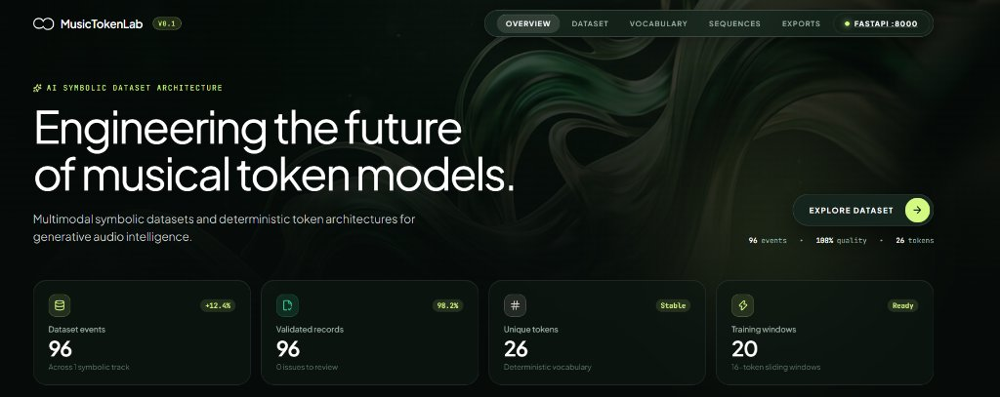
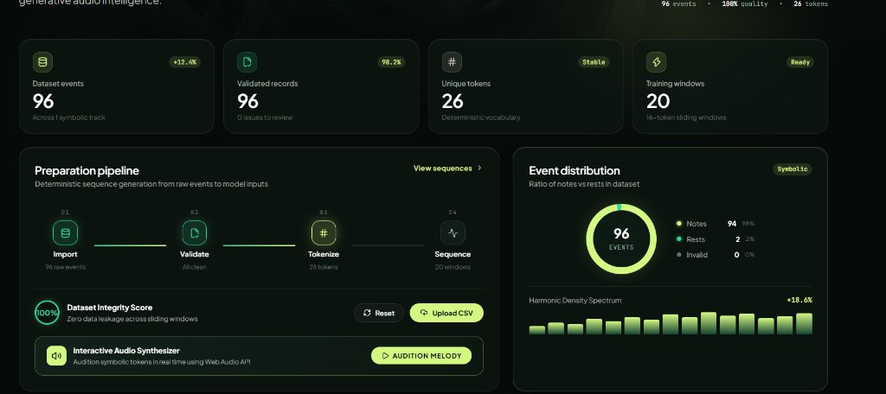
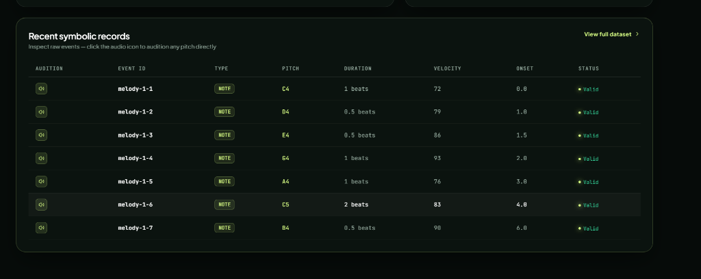

# Music Token Lab

Music Token Lab is a small, inspectable workspace for preparing symbolic music data for model training. It keeps the data flow explicit: import events, validate them, derive a deterministic vocabulary, encode events, and generate next-token sequence windows.



## Features & Screenshots

- **Overview & Real-time Metrics**: Monitor total dataset events, validation health, unique deterministic vocabulary tokens, and generated training windows.
- **Preparation Pipeline & Distribution**: Deterministic sequence generation from raw music events to model inputs, complete with harmonic density spectrum and event ratio charts.

  

- **Interactive Symbolic Dataset Inspection**: Inspect event records, verify validity, and audition individual notes/chords in real-time using the built-in Web Audio API synthesizer.

  

## Run locally

```bash
npm install
npm run dev
```

The frontend runs at `http://localhost:5173`. The UI works with a built-in original synthetic melody, so no external data or API key is required. To run the FastAPI service:

```bash
cd backend
python -m venv .venv
.venv\Scripts\activate
pip install -r requirements.txt
uvicorn app.main:app --reload --port 8000
```

## Workflow

1. Upload a CSV with `track_id`, `instrument`, `pitch`, `duration_beats`, `velocity`, `event_type`, and `onset_beats` columns, or use the included synthetic melody.
2. Inspect validation issues in Dataset prep. Invalid rows remain visible and are never silently deleted.
3. Tokenization creates sorted, deterministic identities such as `NOTE_C4_D1` and `REST_D1`.
4. Sequences use a sliding window, with `input` and one-token-ahead `target` arrays suitable for an LSTM or Transformer.
5. Export cleaned CSV, vocabulary JSON, sequences JSON, or a processing report from Export center.

## API

- `GET /health` — service health check
- `POST /api/validate` — validate event records and report issues
- `POST /api/clean` — return explicitly reviewed valid records and removed row numbers
- `POST /api/vocabulary` — create token-to-ID mappings and frequencies
- `POST /api/encode` — encode events into integer IDs
- `POST /api/decode` — decode IDs to symbolic tokens with unknown handling
- `POST /api/sequences` — generate input/target windows

## Limitations

This starter intentionally handles symbolic event data rather than audio. It does not claim the vocabulary is learned: IDs are derived deterministically from the current dataset. The browser CSV parser is intentionally small and assumes comma-separated values without quoted commas; use the FastAPI service for production-grade parsing and larger files.
